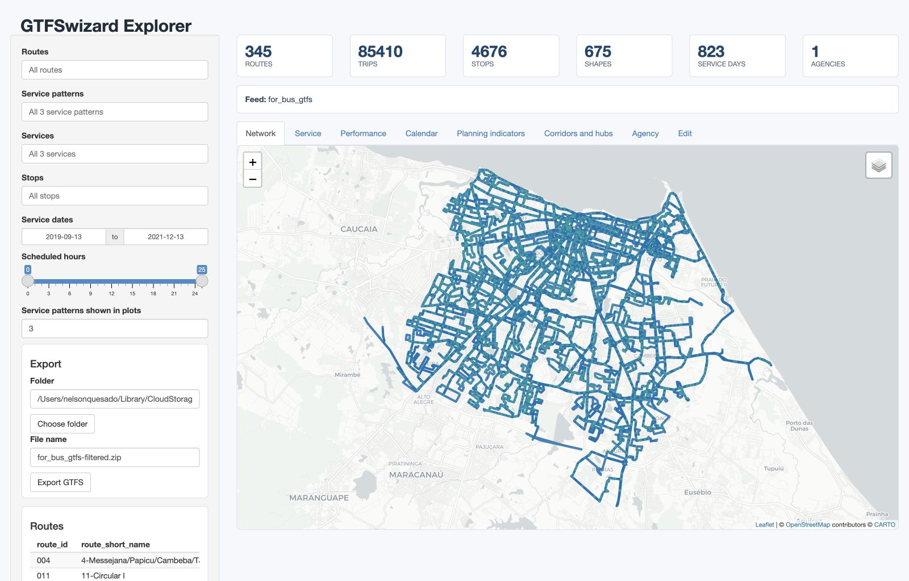

# GTFSwizard

##### Source version 1.2.2 (prepared: 2026-11-16)
##### CRAN version 1.2.2

[](https://lifecycle.r-lib.org/articles/stages.html)
[](https://github.com/nelsonquesado/GTFSwizard)
[](https://CRAN.R-project.org/package=GTFSwizard)
[](https://github.com/nelsonquesado/GTFSwizard/actions/workflows/R-CMD-check.yaml)
[](https://app.codecov.io/gh/nelsonquesado/GTFSwizard)
[](https://CRAN.R-project.org/package=GTFSwizard)
[](https://CRAN.R-project.org/package=GTFSwizard)
[](https://CRAN.R-project.org/package=GTFSwizard)

GTFSwizard is a set of tools for creating, exploring, and manipulating
[General Transit Feed Specification (GTFS)](https://gtfs.org/) files in R.

Its main purpose is to give researchers and practitioners a straightforward
way to explore and simulate changes within GTFS files, which represent public
transportation schedules and geographic data.

## Install

```r
# Stable release
install.packages("GTFSwizard")

# Development version
remotes::install_github(
  "nelsonquesado/GTFSwizard@main"
)
```

## Work With GTFS

- **Create and validate:** build feeds from data frames with
  [`create_gtfs()`](reference/create_gtfs.html), or import an existing archive
  with [`read_gtfs()`](reference/read_gtfs.html). Check the original archive
  against the GTFS specification with [`validate_gtfs()`](reference/validate_gtfs.html).
- **Analyze service:** calculate frequency, headways, dwell time, duration,
  speed, fleet requirements, service span, corridors, and hubs.
- **Build scenarios:** filter routes, services, dates, stops, and time windows;
  then delay, split, merge, or edit scheduled trips.
- **Explore visually:** use [`explore_gtfs()`](reference/explore_gtfs.html) for
  interactive maps, planning indicators, service plots, editing, and export.

## Quick Start

The package includes Fortaleza rail and bus feeds and `bcn_bus_gtfs`, a
historical Barcelona AMB Mobilitat bus feed with six agencies, 128 routes,
25,122 trips, and 3,385 stops.
The main workflows can be tried without downloading external data.

```r
library(GTFSwizard)

gtfs <- for_rail_gtfs
summary(gtfs)

get_frequency(gtfs, method = "by_route")
plot_calendar(gtfs, fill = "service_pattern", facet_by_year = TRUE)
```

Launch the dashboard from an object, or omit the object to choose a GTFS zip
archive interactively.

```r
explore_gtfs(for_rail_gtfs)
# explore_gtfs()
```



## Compare scheduled supply

Use `filter_area()` to select trips serving a study area, then compare two timetables
with `compare_scenarios()` on a common service date. Results include departures,
vehicle-hours, vehicle-kilometres, service span, headway and peak concurrent trips.
The [filtering and editing guide](articles/filtering-editing.html) shows the workflow.

## Guides

- [Getting started](articles/getting-started.html)
- [Validating a feed](articles/validation.html)
- [Service analysis and visualization](articles/service-analysis.html)
- [Filtering, selecting, and editing](articles/filtering-editing.html)
- [Interactive dashboard](articles/explore-dashboard.html)
- [Complete function reference](reference/index.html)
- [Cheat sheet](https://github.com/nelsonquesado/GTFSwizard/blob/main/inst/cheatsheet/GTFSwizard-cheatsheet.html)

## Citation

Use `citation("GTFSwizard")` to obtain the current package citation. Related
publications and project details are listed in the
[repository README](https://github.com/nelsonquesado/GTFSwizard#readme).
